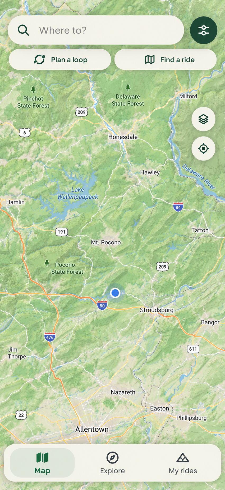
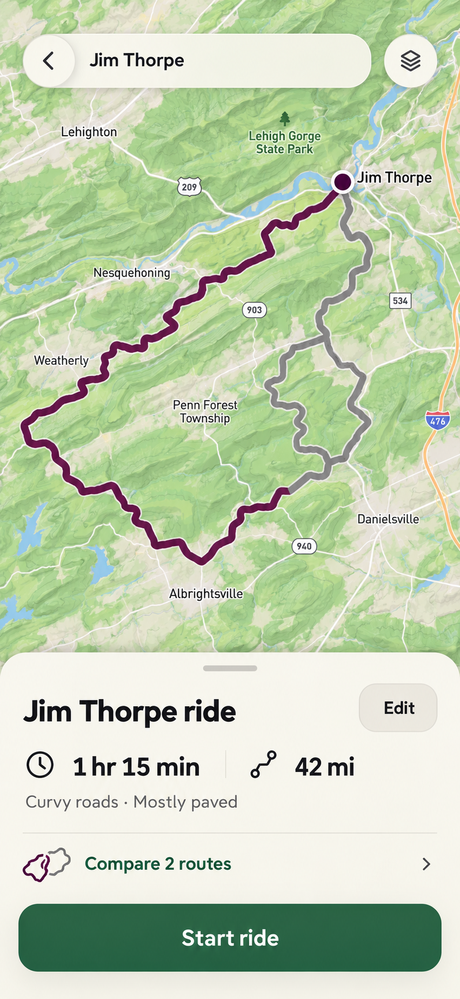
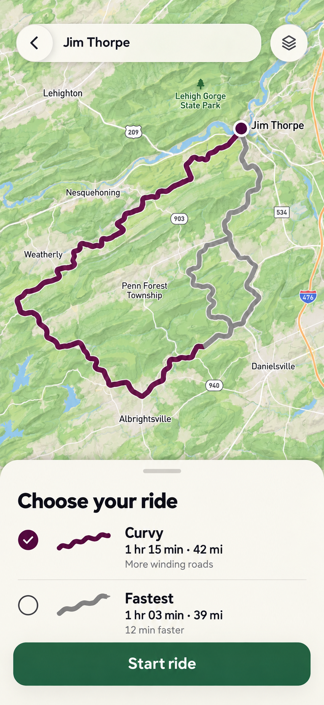
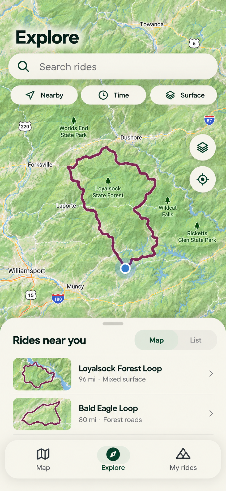
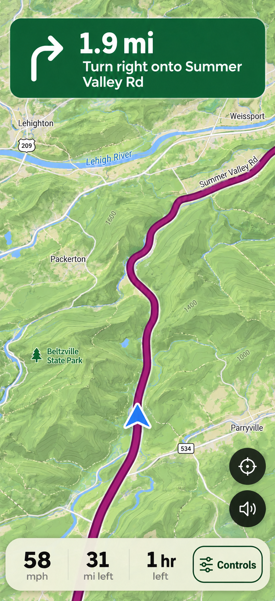
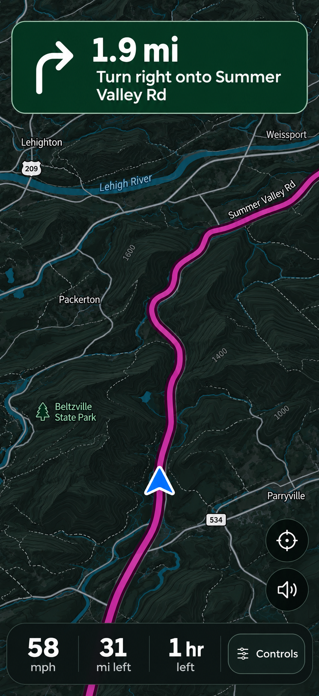
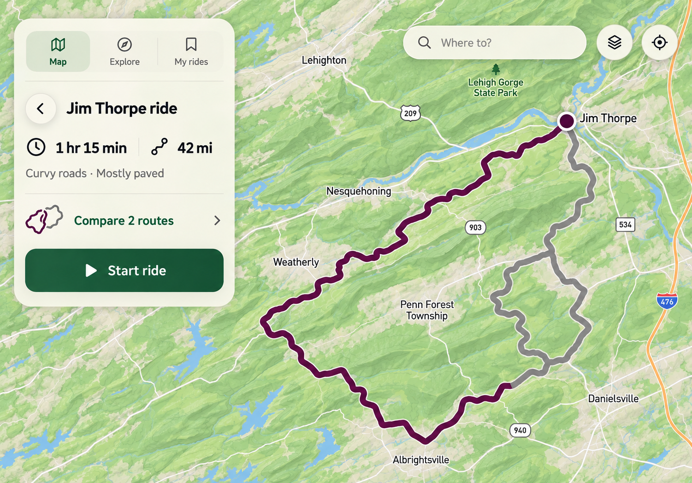

# OpenGravel mobile UX handoff

**Purpose:** give Opus a concrete, code-aware direction for a calmer map,
cleaner bottom navigation, route comparison, Explore and riding surfaces.
This is a **design proposal and implementation handoff**, not a claim that
the pictured screens have been built or verified. It is based on
`OneBigHen/OpenGravel` at `37254edcbc3ee5795c5ed3c85c05e8859d937715`
(2026-10-27); inspect current `origin/main` and open work before starting.

For a checkout that does not yet contain this handoff, the source branch is
`design/mobile-map-handoff-20261027`. Fetch it, then use a separate worktree
for implementation rather than switching or overwriting a dirty checkout:

```bash
git fetch origin
git worktree add ../og-mobile-ux -b ui/mobile-map-ux origin/design/mobile-map-handoff-20261027
cd ../og-mobile-ux
```

Before implementation, compare with the latest `origin/main` and integrate
its changes safely. If that local branch or worktree already exists, choose a
different name; never overwrite another session's work.

Read in this order:

1. This gallery and its caveats.
2. [Interaction and visual specification](SPEC.md).
3. [Opus start prompt](OPUS-PROMPT.md).
4. [Implementation plan](../../../superpowers/plans/2026-10-27-mobile-map-ux.md).
5. The existing `CLAUDE.md`, `DESIGN.md`, `docs/architecture.md`, and the
   design and verification files cited in the specification.

## The direction

One bottom surface has priority at a time: a compact primary navigation on
the idle map and browsable pages; a route sheet in compact route-preview and
editing states; a ride instrument strip during active navigation. A back or
close action returns to the prior context without silently discarding the ride.
Details and editing remain accessible as the sheet expands.

Keep OpenGravel's premium technical-outdoors "trail instrument" identity:
map-first, forest-green primary action, plum chosen route, dense readable glass,
two coordinated themes, and local-first behavior. Optimize for the owner's
iPhone Pro Max, while checking small phones, iPad, and desktop.

## Screens

| View | Reference | What to take from it |
| --- | --- | --- |
| Map home | [01 — Map home](assets/01-map-home-day.png) | Search-led entry and a compact Map / Explore / My rides bar. |
| Route preview | [02 — Route preview](assets/02-route-preview-day.png) | One bottom sheet and one clear primary action. |
| Route comparison | [03 — Route comparison](assets/03-route-compare-day.png) | Simple selectable options and clear tradeoffs. |
| Explore | [04 — Explore](assets/04-explore-day.png) | Map and compact route rows support one another. |
| Ride, day | [05 — Ride day](assets/05-ride-day.png) | Maneuver, map and a compact instrument strip. |
| Ride, night | [06 — Ride night](assets/06-ride-night.png) | A dark basemap as well as dark chrome. |
| iPad, landscape | [07 — iPad landscape](assets/07-ipad-landscape.png) | A map-first, side-rail composition rather than a stretched phone. |









## How to use the images

These are AI-generated visual concepts made with the built-in image tool,
grounded in the repo's existing mobile reference and the prior concepts.
They are not production assets, authoritative maps, GPS traces, legal access
evidence, actual screenshots, tested components, or proof of accessibility.
Names, roads, geometry, map styling, estimates, and icons are illustrative.
Use real MapLibre styles, actual route data, approved tokens, accessible
components and legal attribution. Do not place these images in the runtime app.

Intentional exceptions to the images:

- The home illustration does not show a direct Record or Free Ride control;
  both must stay discoverable and retain their existing capabilities.
- The image uses a sliders glyph by search; implement an explicitly named and
  accessible Settings/menu affordance and retain Settings access on every page.
- The planner image may show less than the project's target visible-map area
  on smaller screens; implement adaptive detents and verify the real layout.
- The ride images show only two map controls for clarity. **Do not remove** the
  existing glove-sized zoom/compass, off-route recovery, recording indication,
  or other ride functionality merely to match the rendering.
- The Explore image depicts a generic selected loop, not the catalog's actual
  track. Do not interpret its map or the image's metrics as ground truth.
- The iPad image demonstrates composition, not exact button placement; avoid
  duplicating search if a From/To control is already active.
- The mockups omit status bars, safe areas and attribution for presentation.
  Real browser/PWA layouts must reserve safe areas and keep map attribution.

## Reproduction briefs

All seven images were generated with the built-in image generator; the first
six mobile concepts use a 440 × 956 conceptual viewport and the iPad concept
uses 1194 × 834 landscape. The prompts specified a single app screen, realistic
Pennsylvania terrain maps, no hardware frame or status bar, restrained glass,
forest-green actions, plum routes, and the following state-specific directions:

1. **Map home:** `Where to?`, `Plan a loop`, `Find a ride`, three-item bottom
   navigation, and a largely unobstructed map.
2. **Route preview:** single bottom sheet with route summary, comparison and
   `Start ride`; no global navigation underneath it.
3. **Route comparison:** selected Curvy and alternate Fastest rows linked to
   route lines, with one Start action.
4. **Explore:** search, Nearby/Time/Surface filters, map and compact route rows.
5. **Ride day:** maneuver, route, instrument strip and low-emphasis Controls;
   revised from the prior concept to remove an oversized red End button.
6. **Ride night:** fully dark basemap and chrome, high-contrast maneuver,
   instrument strip and Controls.
7. **iPad landscape:** compact planning rail, map-first layout, navigation in
   the rail and no redundant bottom bar.

## Decision status

The owner requested further design iteration and a GitHub handoff. The screen
concepts and navigation changes are a proposal for Opus, not a modification of
the locked `DESIGN.md` rules or a deployed implementation. `DESIGN.md` says
the owner must approve changes to its locked rules. If the owner instructs
Opus to implement this proposal, record which rules are superseded and why;
do not silently claim the earlier rules already say the same thing.
